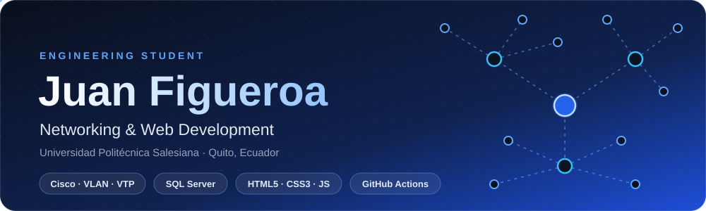
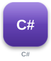

 

&nbsp;&nbsp;
&nbsp;&nbsp;

## 👨‍💻 About Me

- 🎓 Engineering student at **Universidad Politécnica Salesiana** (Quito, Ecuador).
- 🛰️ **Cisco networking:** VLANs, VTP and inter-VLAN routing.
- 🗄️ **Databases:** management and optimization with **SQL Server** and MySQL.
- 🌐 **Web:** responsive interfaces with HTML5, CSS3 and JavaScript.
- ⚙️ **Automation:** GitHub Actions workflows.
- 🛠️ Currently leading the web development of the **Museo de San Francisco** project.

## 🚀 Featured Project

<!-- TODO: replace the href with the repo or live site of the project -->

## 🛠️ Tech Stack

**Frontend** 

**Languages** 

**Databases** 

**Networking & Tools** 

## 🌐 Networking Skills

| Topic | What I do |
| :--- | :--- |
| 🔀 **VLANs** | Segment networks by department or function |
| 🔄 **VTP** | Centralized VLAN management across switches |
| 🛣️ **Inter-VLAN routing** | Communication between VLANs through a router / L3 switch |
| 🧪 **Tools** | Cisco Packet Tracer and CLI configuration |

## 📊 GitHub Stats

  
  

  

<!-- Generated by .github/workflows/profile-3d.yml. Run it once from the Actions tab before this image shows up. -->

  

⭐ Thanks for visiting my profile — feel free to reach out!

